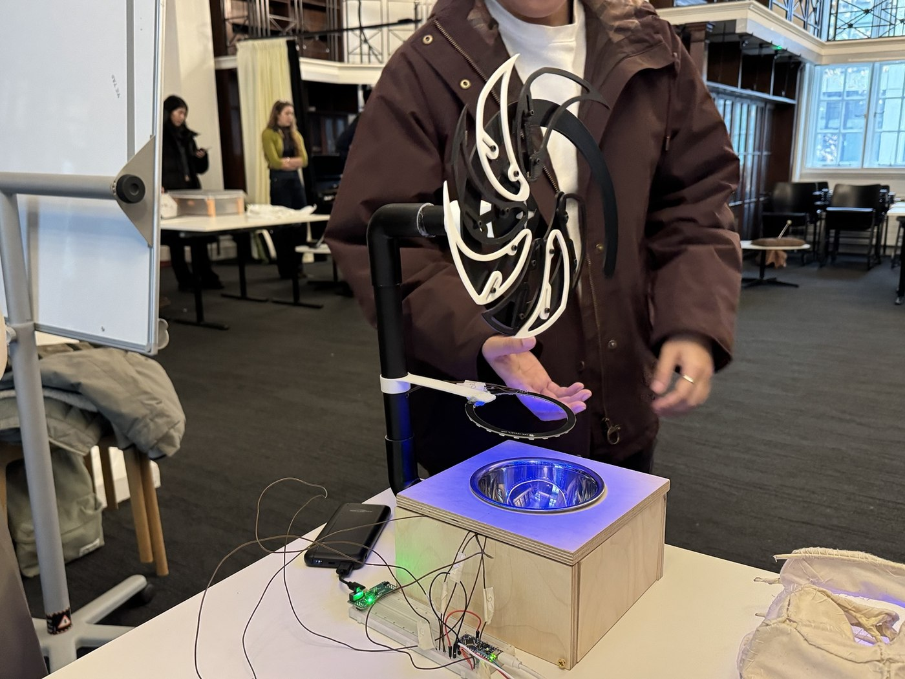
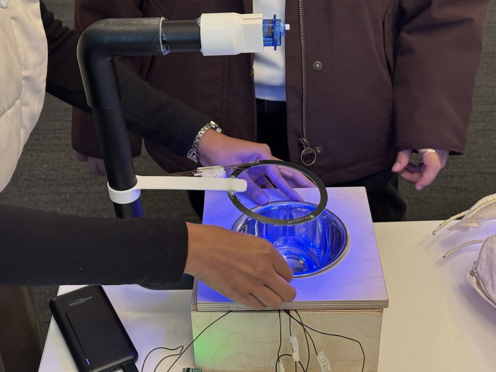
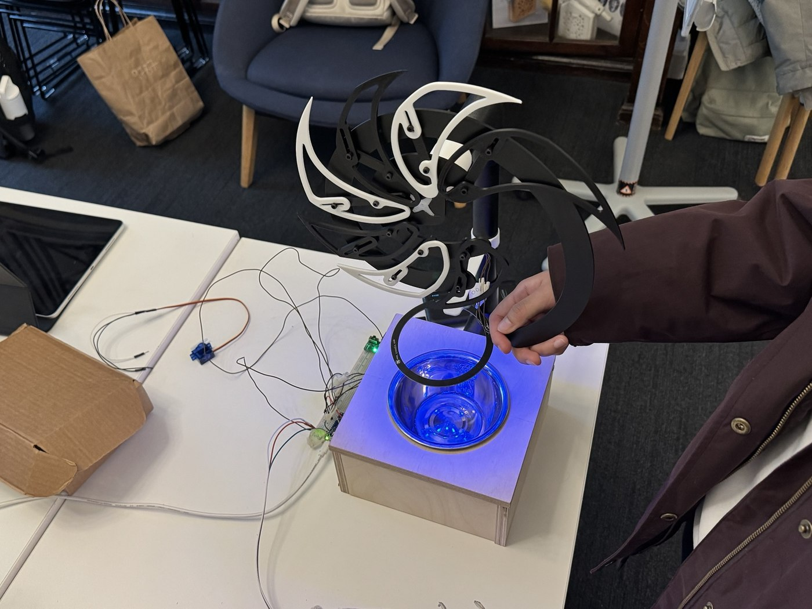
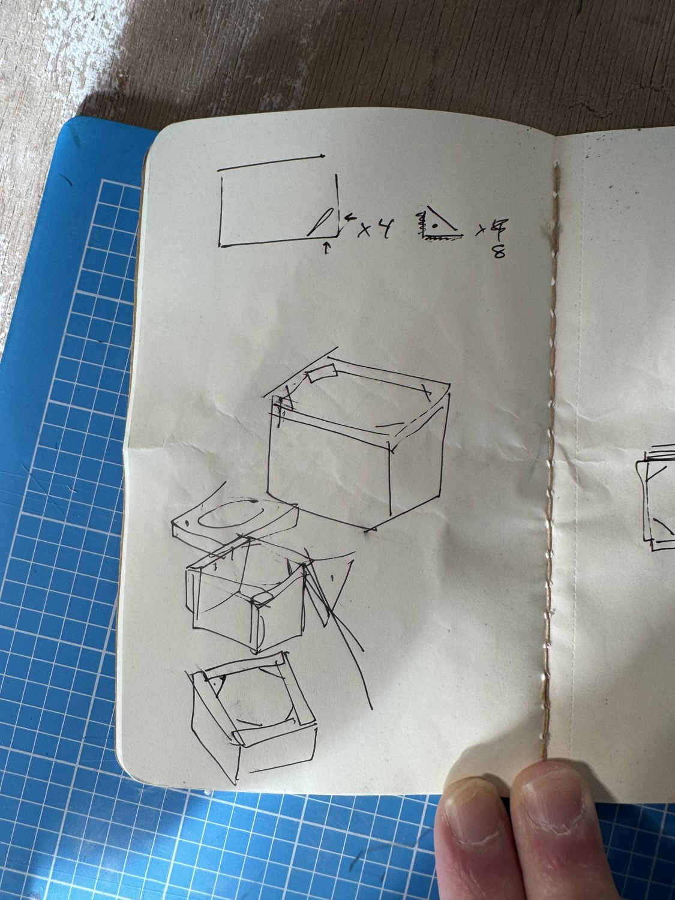
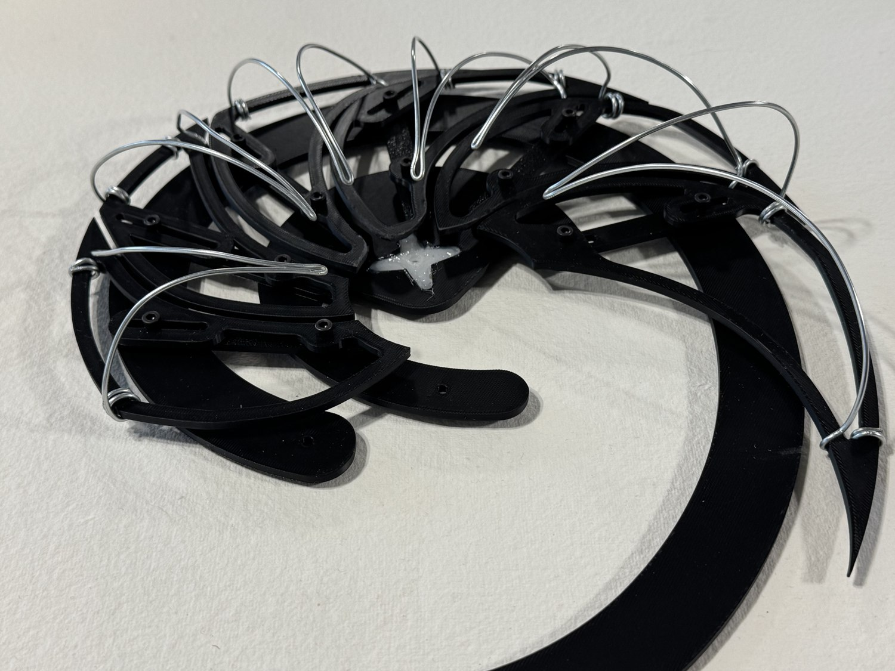
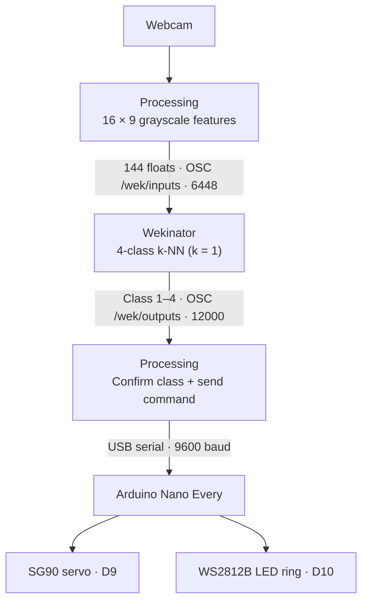
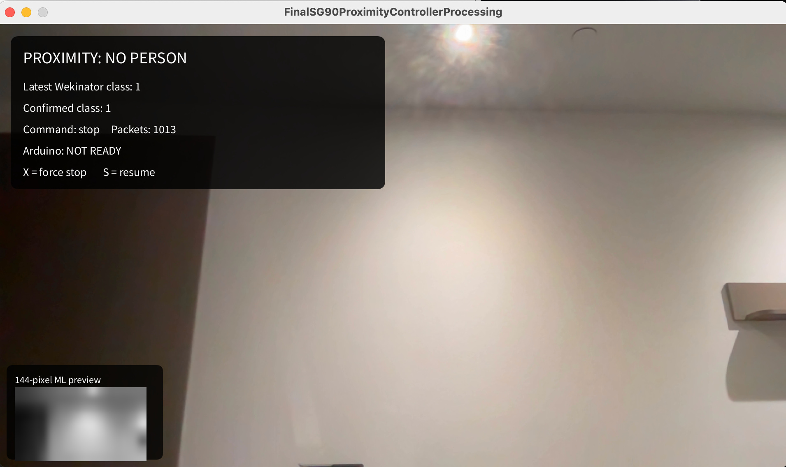
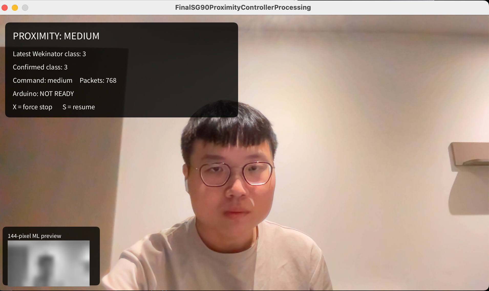
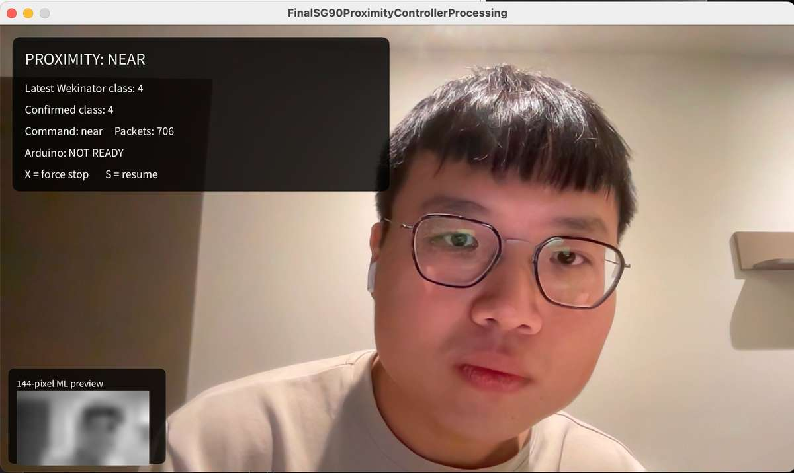
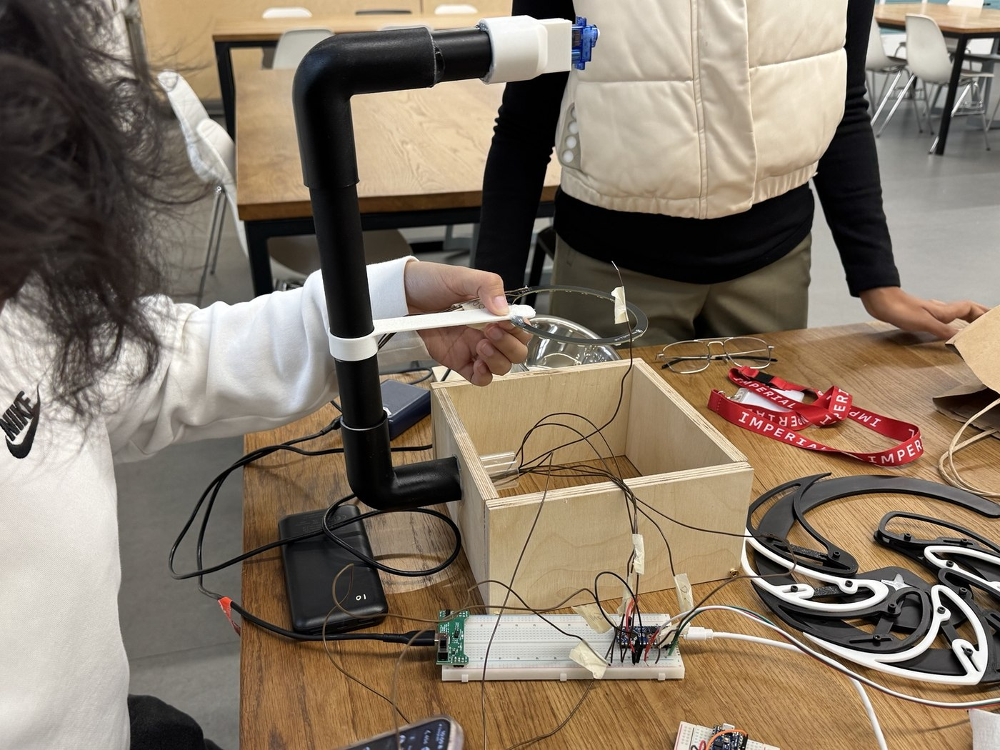

# Group 10 — Proximity-Responsive Kinetic Installation

**Cyber Physical Systems · 2026**

We built an installation that responds to how close someone appears to a webcam. A machine-learning model classifies the camera view into four proximity states. Those states change the movement of a servo-driven kinetic structure and the brightness of a blue LED ring above a reflective basin.

*The assembled installation during our final demonstration.*

[See the prototype](#the-prototype) · [Development](docs/development-process.md) · [How it works](#how-it-works) · [Interaction modes](#interaction-modes) · [Source code](#source-code) · [Testing](#testing) · [Setup](#running-the-project)

## The prototype

[**Watch a short demonstration**](media/videos/final-demonstration.mp4)

| Interaction around the light | Kinetic structure and base |
|:---:|:---:|
|  |  |

The installation combines a fabricated plywood enclosure, a mounted kinetic assembly, a positional servo, and a 24-LED addressable ring. The webcam is our input; movement and illumination are the outputs.

### Development in brief

| Exploring the form | Building the mechanism |
|:---:|:---:|
|  |  |

We explored the installation through sketches and physical mock-ups before fabricating the plywood base and integrating the servo, LED ring, and control electronics. [See our development photographs and short clips](docs/development-process.md).

## How it works

Processing captures the webcam image, reduces it to a **16 × 9 grayscale grid**, and sends its **144 normalised pixel values** to Wekinator. Wekinator returns a class prediction. Processing checks for consecutive matching predictions before sending `stop`, `far`, `medium`, or `near` to the Arduino.

We use the same serial command for both outputs, so the servo motion and light level change together.

### Interaction modes

| Class | Camera scene | Command | Servo movement | LED brightness |
|---|---|---|---|---|
| 1 | **EMPTY** — no person | `stop` | Returns to 0° | Off |
| 2 | **FAR** | `far` | Repeats 0°–5°; 100 ms per 1° step | Blue, 33% |
| 3 | **MEDIUM** | `medium` | Repeats 0°–15°; 50 ms per 1° step | Blue, 67% |
| 4 | **NEAR** | `near` | Repeats 0°–30°; 20 ms per 1° step | Blue, 100% |

The LED percentages are relative to a deliberately limited **FastLED brightness setting of 30/255**: the four modes use values **0, 10, 20, and 30**. Servo times describe commanded steps rather than measured physical speed.

## Source code

| File | What it does |
|---|---|
| [**Arduino — FinalSG90ProximityController.ino**](software/arduino/FinalSG90ProximityController/FinalSG90ProximityController.ino) | Receives serial commands; sets sweep ranges and timings; controls LED brightness using FastLED |
| [**Processing — FinalSG90ProximityControllerProcessing.pde**](software/processing/FinalSG90ProximityControllerProcessing/FinalSG90ProximityControllerProcessing.pde) | Reads the camera; prepares 144 inputs; exchanges OSC messages with Wekinator; filters classes; sends serial commands |
| [**Wekinator — WekinatorProject3**](software/wekinator/WekinatorProject3/WekinatorProject3.wekproj) | Saved classifier, training data, and model configuration |
| [**Standalone LED test — RingLEDLight.ino**](tests/07-led-ring/RingLEDLight/RingLEDLight.ino) | Checks that the LED ring can be controlled independently |

[**Processing implementation, earlier experiments and serial test**](software/processing/README.md) document how the webcam-to-Wekinator-to-Arduino interface developed and how its communication can be checked separately.

For historical context, we also preserved the [early two-command Processing-to-Arduino servo receiver](tests/08-early-servo-serial/README.md). It is an archived experiment, not the controller used by the finished installation.

The Arduino sweep uses `millis()` instead of blocking delays. Processing sends commands when the confirmed class changes and repeats the active command approximately every 200 ms. If Arduino receives no valid command for more than one second, it returns to the empty state and turns off the LEDs.

## Machine learning

We trained Wekinator using a **1-nearest-neighbour classifier (k = 1)** and examples recorded for four camera scenes. The saved model compares each incoming 144-value input with the recorded examples and predicts the class of its closest neighbour. We chose this straightforward approach because it is easy to train and update during prototyping.

The final saved dataset contains **2,029 examples**:

| EMPTY | FAR | MEDIUM | NEAR | Total |
|---:|---:|---:|---:|---:|
| 551 | 671 | 505 | 302 | **2,029** |

### Classification in Processing

These screenshots show three of the four proximity states captured during classifier testing. Processing displays the Wekinator prediction, the confirmed class, and the corresponding control command.

| EMPTY — Class 1 | MEDIUM — Class 3 | NEAR — Class 4 |
|:---:|:---:|:---:|
|  |  |  |
| `stop` | `medium` | `near` |

*These captures document classification in Processing. The Arduino status reads NOT READY, so they are evidence of camera and machine-learning behaviour rather than of physical actuation.*

The model does **not** measure distance in metres. It identifies visual patterns associated with our training scenes, so camera angle, background, lighting, clothing, and other people in frame can change the result. The figures above describe the training data, not classification accuracy. A further evaluation would compare predictions across new people and environments and explore alternative models or more balanced training data.

## Testing

We tested individual components during development before combining them into a camera-to-output system. The test procedures and recorded evidence are kept separately from this overview:

- [**Test procedures**](tests/README.md)
- [**Test results and observations**](tests/TEST_RESULTS.md)

The tests cover servo position, serial communication, Wekinator classification, and end-to-end behaviour. We also used a [standalone LED sketch](tests/07-led-ring/RingLEDLight/RingLEDLight.ino) before integrating the ring with the servo controller.

*An earlier build stage, before the final installation was assembled.*

## Running the project

**You will need:** an Arduino Nano Every, SG90 positional servo, 24-pixel WS2812B LED ring, webcam, a suitable regulated external 5 V supply for the servo and LEDs, and a shared ground with the Arduino. The software uses Arduino IDE (`Servo`, `FastLED`), Processing Java mode (`Video`, `Serial`, `oscP5`), and Wekinator.

1. **Connect the hardware.** Servo signal goes to **D9** and LED data input to **D10**. Verify the supply and ground connections before powering anything.
2. **Upload the [Arduino sketch](software/arduino/FinalSG90ProximityController/FinalSG90ProximityController.ino).** Select *Arduino Nano Every* and the correct USB port. Close Processing and Arduino Serial Monitor during the upload.
3. **Open the [Wekinator project](software/wekinator/WekinatorProject3/WekinatorProject3.wekproj).** It expects 144 inputs, one four-class output, and OSC ports **6448** (input) and **12000** (output).
4. **Run the [Processing sketch](software/processing/FinalSG90ProximityControllerProcessing/FinalSG90ProximityControllerProcessing.pde).** Set `ARDUINO_PORT` to the port listed on your computer. Start Wekinator's **Run** mode to receive class predictions.
5. **Try the four proximity scenes.** Watch the latest and confirmed classes in Processing and check the servo and LED responses. Press **X** to request software stop or **S** to resume.

The software stop is not a power cut-off. The ring and servo should not be powered through the Arduino's USB connection to the laptop.

## What we would improve

Stability of the mechanism would improve if it were not directly mounted onto the servo motor. Additionally, a higher torque motor may be used in order to turn the fully loaded mechanism. With more time, we would also test the model on new participants and locations, measure response time, and refine how it handles changing scenes.

## Team

**Group 10**

Julia Becker · Givson Ong · Sejal Mittal

### Acknowledgements

We used **OpenAI ChatGPT (GPT-6)** during development to help draft and troubleshoot portions of the Arduino and Processing code and to edit documentation. We reviewed and adapted those suggestions for our prototype.

**AI tool reference:** OpenAI. (2026). *ChatGPT (GPT-6)* [Generative AI assistant]. https://chatgpt.com/ (used October–November 2026).

Our software also uses the Arduino Servo and FastLED libraries, Processing and oscP5, and Wekinator.
