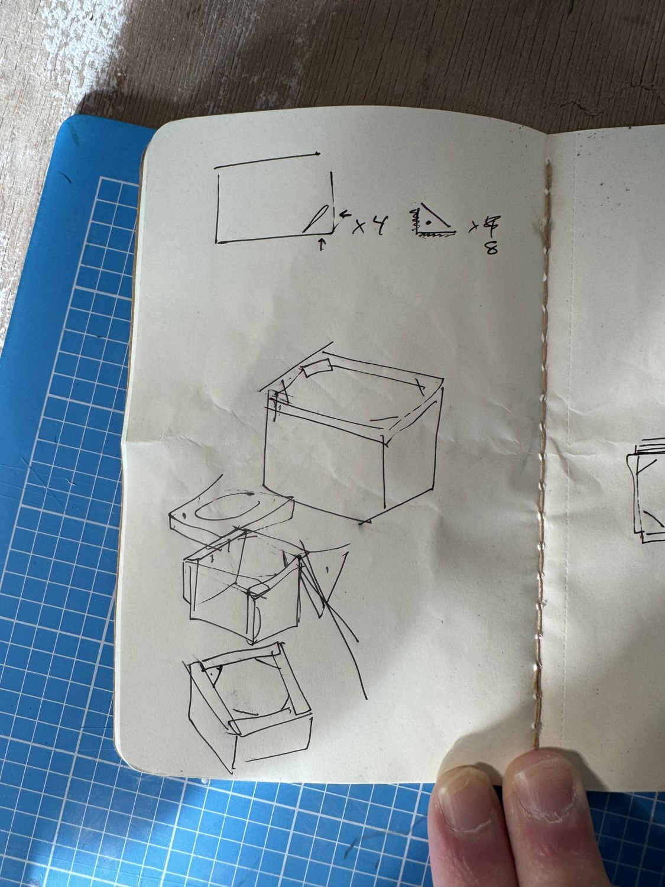
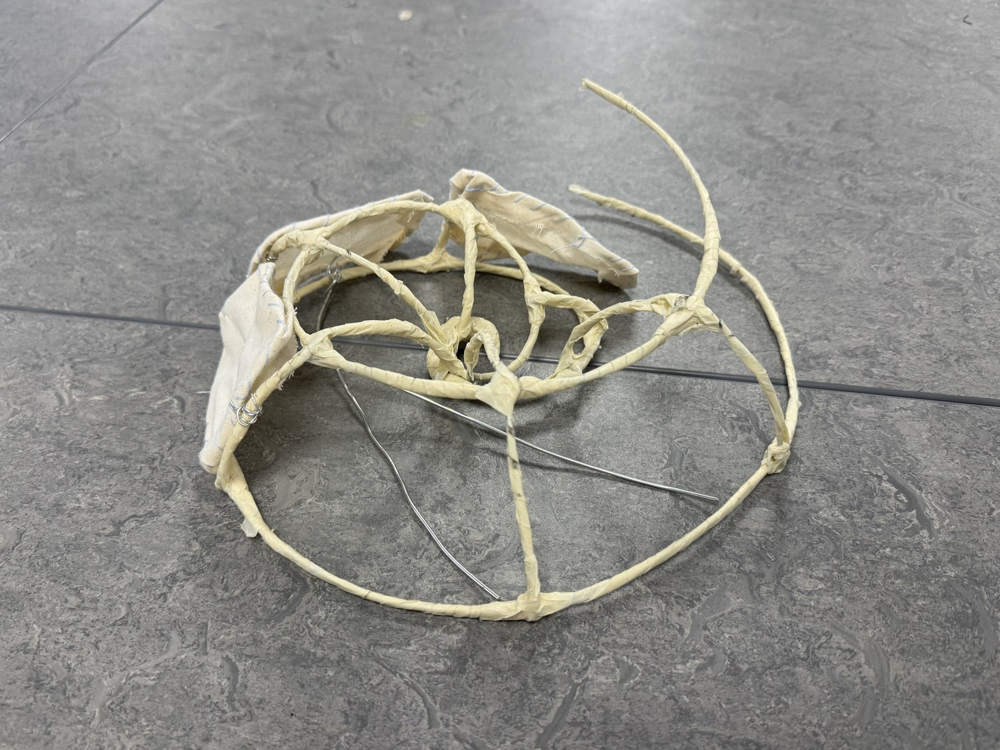
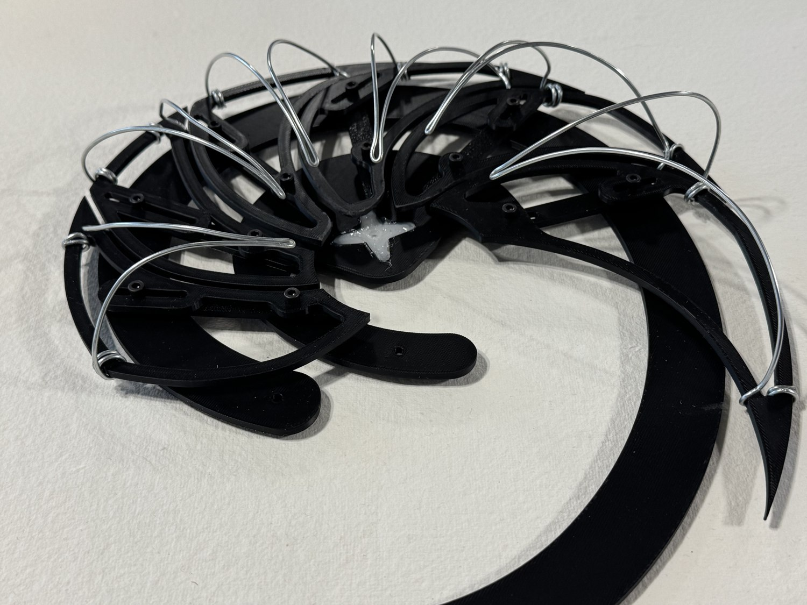
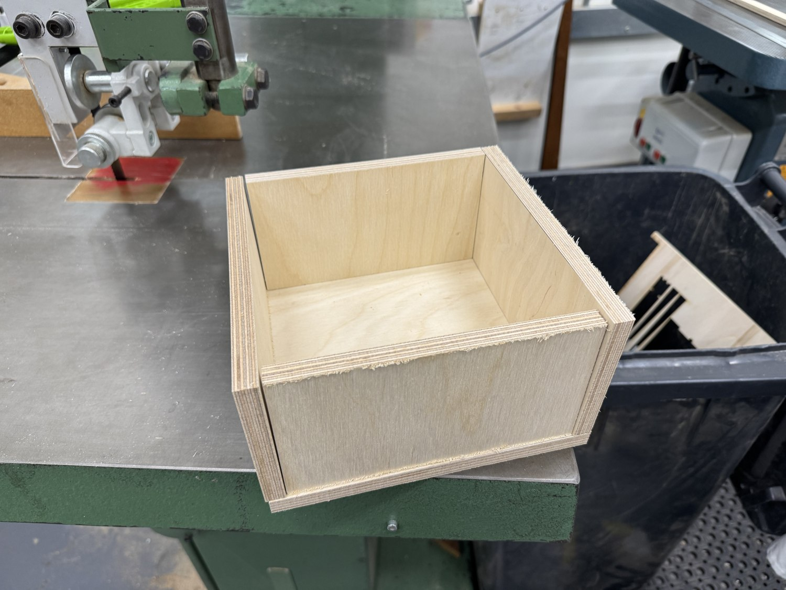
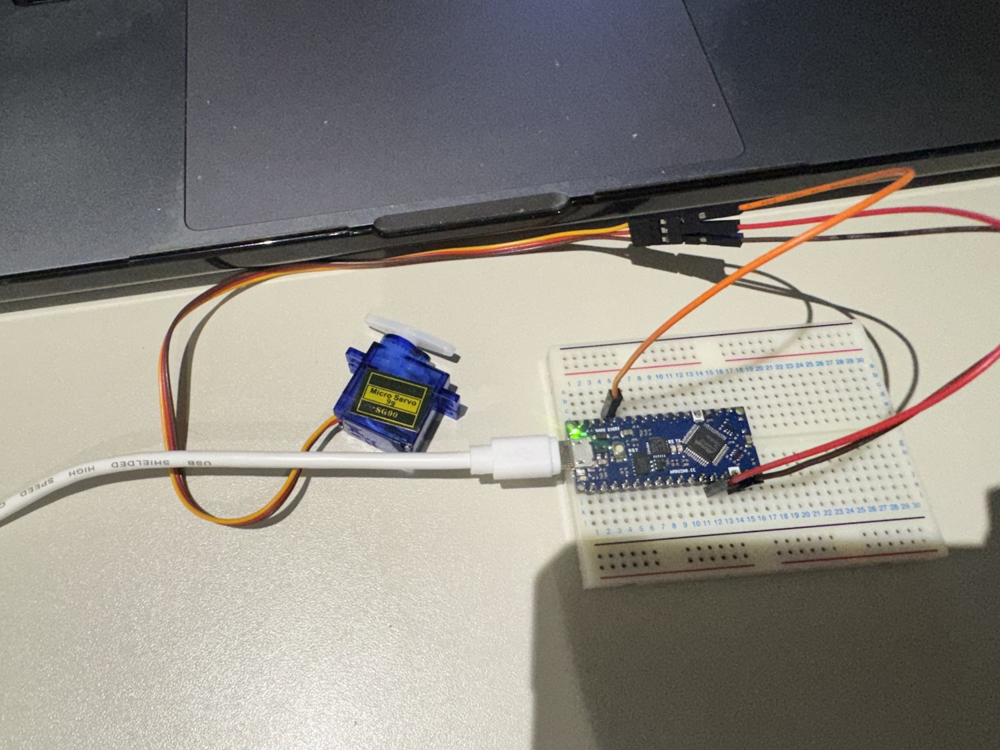
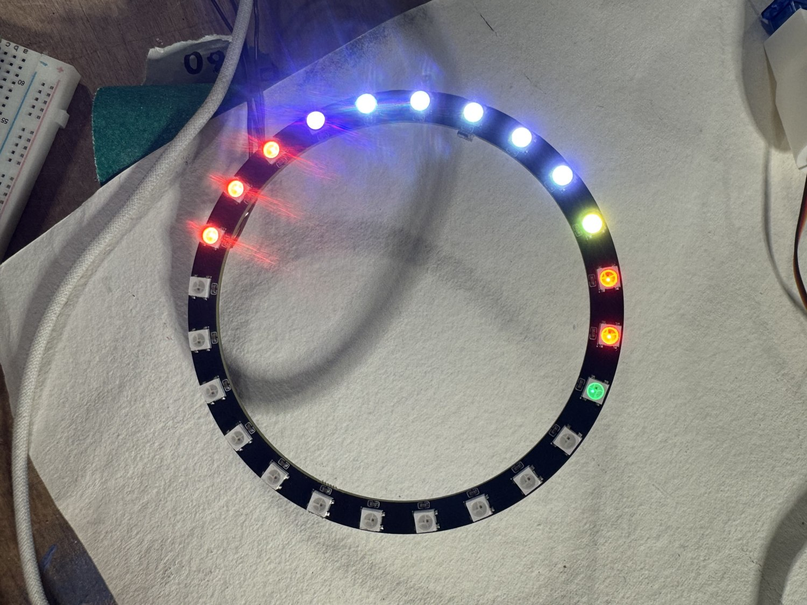
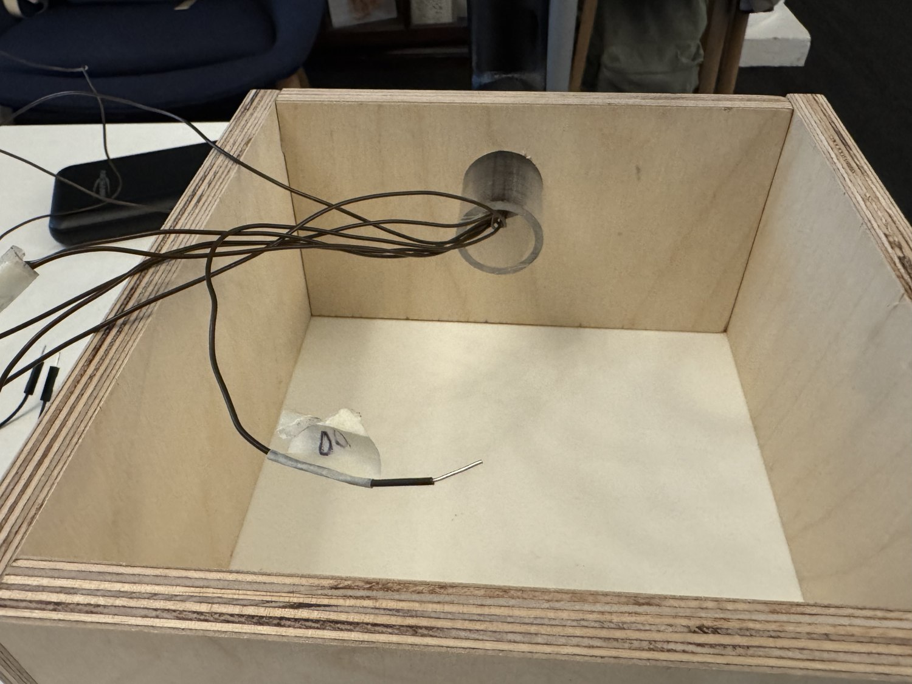
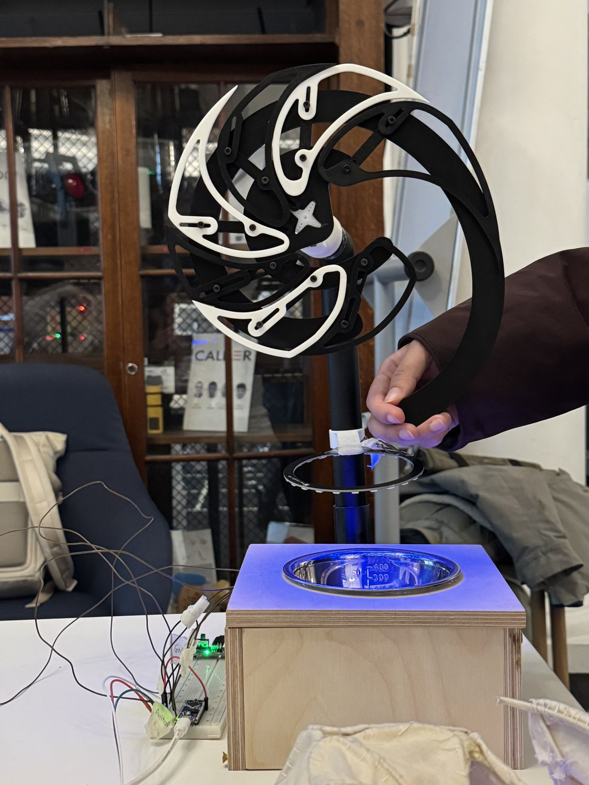

# Development process

[← Back to project overview](../README.md)

This page brings together photographs and short clips from the development of our proximity-responsive kinetic installation. They show how we explored the form, assembled the mechanism, built the enclosure, and checked the electronics before the final demonstration.

## 1. Early form studies

| Sketches of the proposed installation | Physical form exploration |
|:---:|:---:|
|  |  |

These early images show different ways of arranging the installation's enclosure and curved moving elements. They help explain the transition from an exploratory form to a mechanically assembled structure.

## 2. Building the kinetic structure and enclosure

| Kinetic component laid out for assembly | Plywood enclosure during fabrication |
|:---:|:---:|
|  |  |

The curved components were assembled into the moving structure, with the enclosure built separately to house the illuminated basin and electronics.

**Development clips:** [Shell assembly test](../media/videos/mechanical-shell-assembly-0590.mp4) · [Mechanical shell close-up](../media/videos/mechanical-shell-closeup-0601.mp4) · [Earlier mechanism handling](../media/videos/mechanism-assembly-test.mp4) · [Digital motion study](../media/videos/digital-motion-study.mp4)

The servo moved during our standalone checks, but struggled once the shell was attached. The assembled mechanism also needed more support to stay stable. We adjusted the movement ranges and speeds as we worked through those constraints. The footage shows the assembly being handled; it does not measure the load or torque involved. [We discuss this in the testing notes.](../tests/README.md#3-how-the-tests-developed-with-the-project)

## 3. Electronics and lighting tests

| Servo and Arduino on a breadboard | LED ring during a colour test |
|:---:|:---:|
|  |  |

The images show isolated electronics and light tests. The multicolour LED image represents an earlier experiment; the final integrated program uses blue illumination at four brightness levels. These photographs illustrate the setup but do not substitute for recorded electrical measurements or complete test results. We kept the [servo position test](../tests/01-servo-position/README.md) and [LED ring test sketch](../tests/07-led-ring/RingLEDLight/RingLEDLight.ino) with the other debugging files.

## 4. Integration and final demonstration

| Wiring inside the open enclosure | Assembled prototype in use |
|:---:|:---:|
|  |  |

The assembled installation combined the kinetic structure, servo, LED ring, plywood enclosure, webcam, Processing interface, and Wekinator classification model.

- [Watch the final demonstration](../media/videos/final-demonstration.mp4)
- [Read the test procedures](../tests/README.md)
- [Read the test observations](../tests/TEST_RESULTS.md)

**Note:** These are selected development photographs and clips, rather than a complete chronological build log. Any claims about performance should be supported by the corresponding tests and observations.