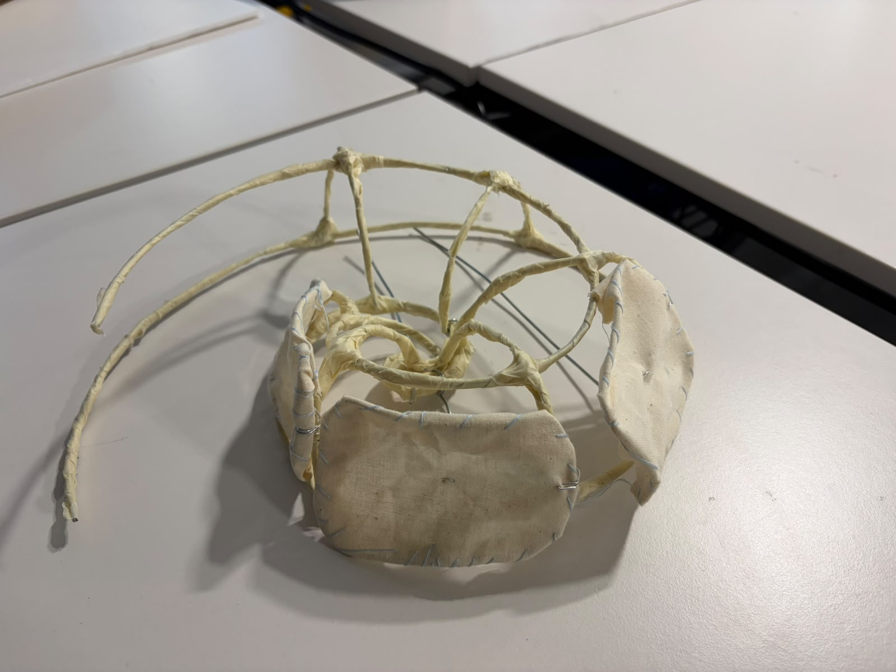
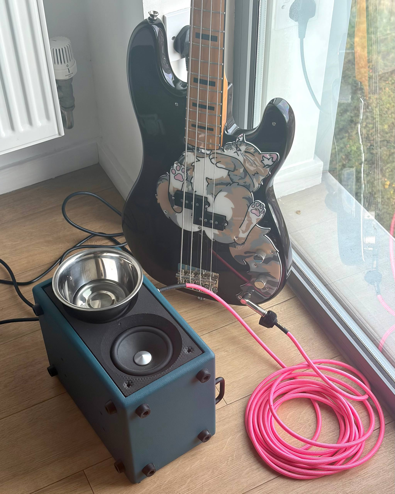
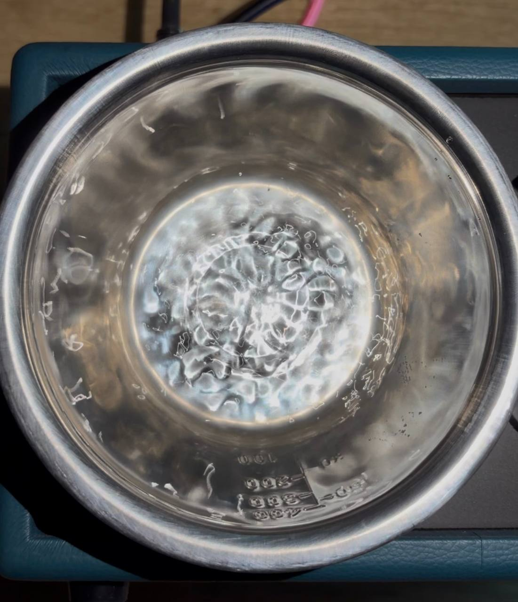
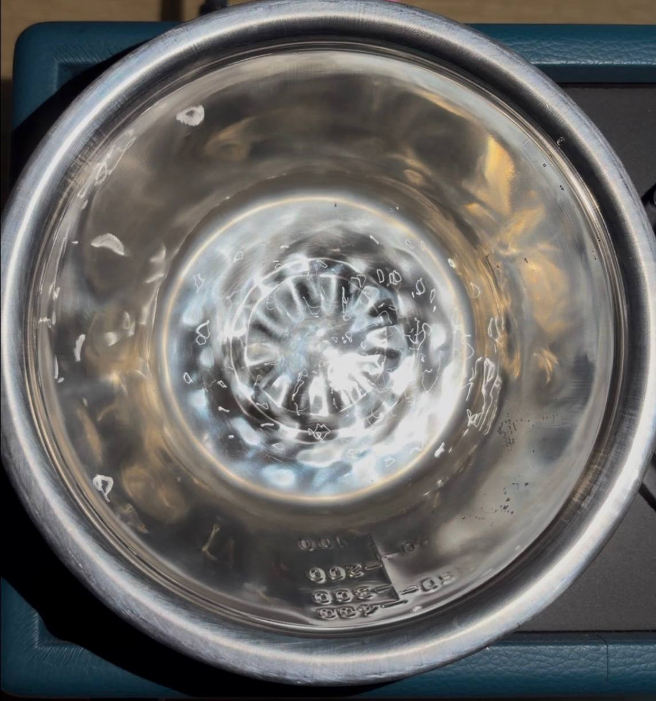

# Development process

[← Back to project overview](../README.md)

This page brings together photographs and short clips from the development of our proximity-responsive kinetic installation. They show how we explored the form, assembled the mechanism, built the enclosure, and checked the electronics before the final demonstration.

## 1. Early design and shell studies

| Enclosure design sketches | Nautilus-inspired shell prototype |
|:---:|:---:|
|  |  |

The sketches on the left explore the design and arrangement of the overall form of the kinetic installation. On the right is an early physical prototype of our kinetic shell lamp, inspired by the curved chambers and spiral geometry of the nautilus shell. These studies represent two related parts of the development process: designing the housing for the installation and exploring the form of its moving structure. 

Overall, we plan to create a light- and sound-based nautilus shell structure. The nautilus shell will be a kinetic lamp, shining downwards onto a bowl of water, which is directly attached to a speaker outputting sound and agitating the water. The kinetic lamp will move based on proximity of users, whilst the speaker output will be adjusted based on the volume of nearby users.

**Nautilus form references:** [Chambered nautilus shell — Science Photo Library (via Pixels)](https://pixels.com/featured/chambered-nautilus-shell-gilles-mermet.html) · [Chambered nautilus shell detail — UK Posters](https://www.ukposters.co.uk/art-photo/seashell-chambered-nautilus-shell-detail-v137938)

### Wire-frame proof of concept

To explore the nautilus-inspired spiral before constructing the final mechanism, we shaped wire into a lightweight framework and adjusted its curves and connections by hand. This early proof of concept helped us explore the overall spiral form and how its supporting ribs could be arranged.

| Initial spiral wire frame | Shaping and joining the wire |
|:---:|:---:|
|  |  |

We then experimented with attaching fabric panels to the curved framework. Covering portions of the wire structure helped us explore how an open skeletal form could develop into the shell's three-dimensional surfaces, whilst allowing light to pass through.

| Attaching fabric panels | Fabric-covered shell study |
|:---:|:---:|
|  |  |

These photographs document exploratory form-making and construction, rather than measured tests of structural strength or servo performance.

## 2. Testing the visual effect of the speaker on water

| Setup | Visual effect on water |
|:---:|:---:|
|  |    |

In order to test the effect that a speaker has on water, we created the above test setup using a bass guitar, bass amp, and a metal bowl with water sitting directly atop the speaker horn. The testing was carried out in a dark room, with a flashlight as the light source. We found that frequencies of 40.2Hz and 55Hz created the best visual effects, pictured above. Based on our tests, we predict that changing the frequency of the speaker output as well as changing the way the light hits the water based on user interaction should result in a fairly interesting visual effect.

## 3. Building the kinetic structure and enclosure

| Kinetic component laid out for assembly | Plywood enclosure during fabrication |
|:---:|:---:|
|  |  |

The curved components were assembled into the moving structure, with the enclosure built separately to house the illuminated basin and electronics.

**Development clips:** [Shell assembly test](../media/videos/mechanical-shell-assembly-0590.mp4) · [Mechanical shell close-up](../media/videos/mechanical-shell-closeup-0601.mp4) · [Earlier mechanism handling](../media/videos/mechanism-assembly-test.mp4) · [Digital motion study](../media/videos/digital-motion-study.mp4)

The servo moved during our standalone checks, but struggled once the shell was attached. The assembled mechanism also needed more support to stay stable. We adjusted the movement ranges and speeds as we worked through those constraints. The footage shows the assembly being handled; it does not measure the load or torque involved. [We discuss this in the testing notes.](../tests/README.md#3-how-the-tests-developed-with-the-project)

## 4. Electronics and lighting tests

| Servo and Arduino on a breadboard | LED ring during a colour test |
|:---:|:---:|
|  |  |

The images show isolated electronics and light tests. The multicolour LED image represents an earlier experiment; the final integrated program uses blue illumination at four brightness levels. These photographs illustrate the setup but do not substitute for recorded electrical measurements or complete test results. We kept the [servo position test](../tests/01-servo-position/README.md) and [LED ring test sketch](../tests/07-led-ring/RingLEDLight/RingLEDLight.ino) with the other debugging files.

## 5. Integration and final demonstration

| Wiring inside the open enclosure | Assembled prototype in use |
|:---:|:---:|
|  |  |

The assembled installation combined the kinetic structure, servo, LED ring, plywood enclosure, webcam, Processing interface, and Wekinator classification model.

- [Watch the final demonstration](../media/videos/final-demonstration.mp4)
- [Read the test procedures](../tests/README.md)
- [Read the test observations](../tests/TEST_RESULTS.md)

**Note:** These are selected development photographs and clips, rather than a complete chronological build log. Any claims about performance should be supported by the corresponding tests and observations.
