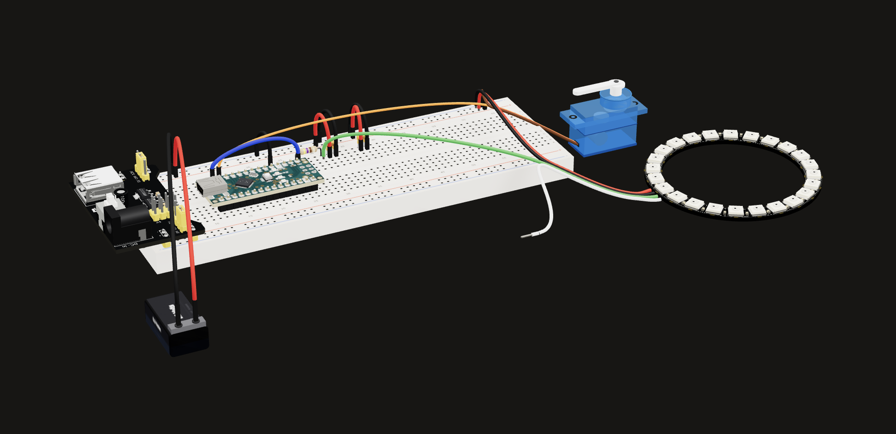
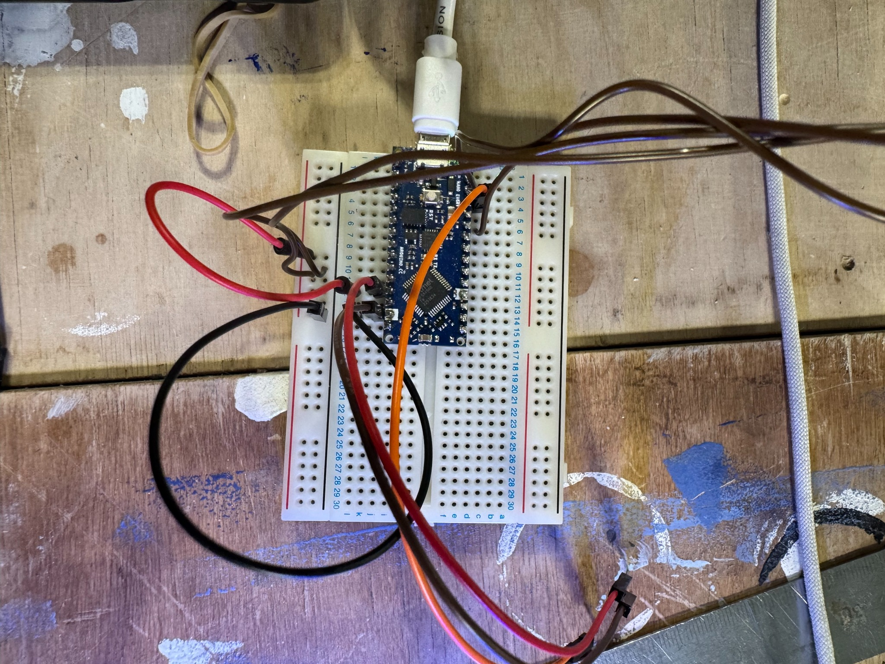
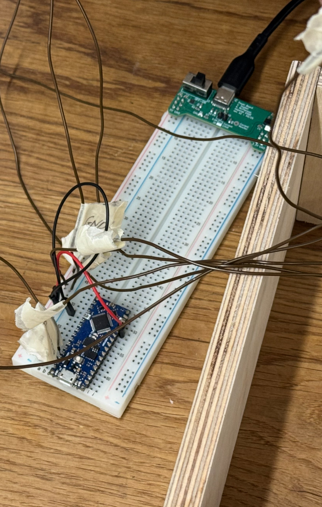
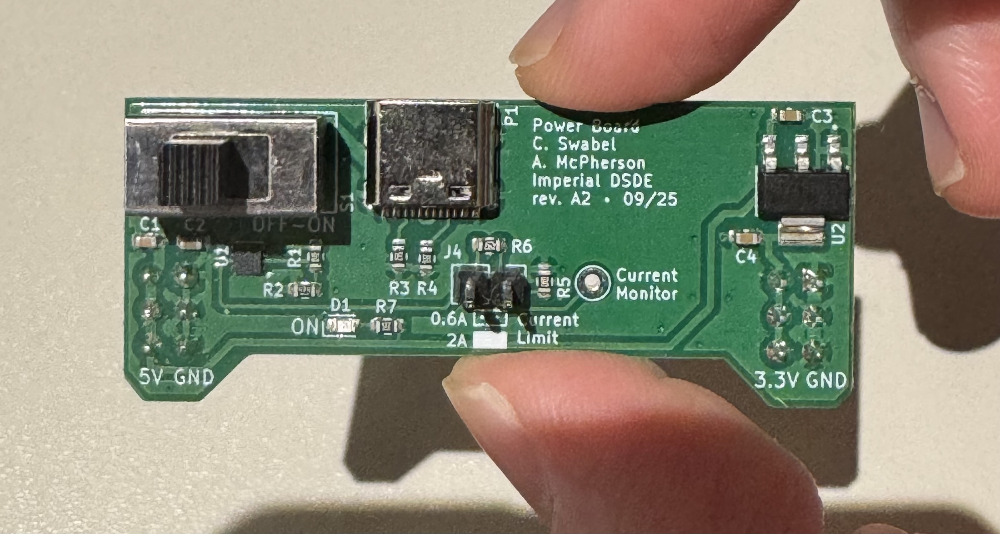

# Arduino — servo movement and LED ring control

[← Main project](../../README.md) · [Final Arduino sketch](FinalSG90ProximityController/FinalSG90ProximityController.ino) · [Processing documentation](../processing/README.md) · [Wekinator documentation](../wekinator/README.md) · [Testing](../../tests/README.md)

## 1. Overview

We used an **Arduino Nano Every** to control the two physical outputs of our installation: an **SG90 positional servo**, which moves the kinetic structure, and a **24-pixel WS2812B LED ring**, which changes the brightness of the blue light.

The Arduino is the last part of our software pipeline. Processing handles the webcam input and communicates with Wekinator, while Wekinator predicts one of four proximity classes. Once Processing has confirmed a class, it sends a short text command to Arduino. The Arduino then determines how far and how quickly the servo should sweep, as well as how bright the LED ring should be.

```text
Webcam → Processing → Wekinator → Processing
                                  │
                                  └── USB serial, 9600 baud
                                       ↓
                                 Arduino Nano Every
                                  ├── D9 → SG90 servo
                                  └── D10 → WS2812B LED ring
```

Our final program is [`FinalSG90ProximityController.ino`](FinalSG90ProximityController/FinalSG90ProximityController.ino). We have kept the earlier component and communication sketches in the [testing folder](../../tests/README.md) so that the development process can be followed separately from the final code.

## 2. How the controller developed

We started by checking whether Arduino could move the servo on its own, then explored how to send commands from a computer over USB serial. These early checks helped us separate basic motor behaviour from problems with communication or machine learning. The [servo position test](../../tests/01-servo-position/README.md), [pulse diagnostic](../../tests/02-servo-pulse-diagnostic/README.md) and [serial parser test](../../tests/03-arduino-serial/README.md) document some of those steps.

We also kept an [earlier `start`/`stop` servo sketch](../../tests/08-early-servo-serial/README.md). It receives simple commands from Processing and makes the servo sweep or hold its position. It may have been used while we were exploring a connection between Wekinator, Processing and Arduino, although that particular file does not tell us whether the full connection was tested successfully.

The servo responded during our standalone checks, but things became more difficult when we attached the kinetic shell. The extra load affected movement, and the assembled structure needed more support to stay stable. As a result, we moved away from our earlier fixed target positions and developed smaller, repeated sweeps with different ranges and speeds for each proximity state.

We tested the [LED ring separately](../../tests/07-led-ring/RingLEDLight/RingLEDLight.ino) before combining the movement and lighting in one Arduino program. The final controller accepts four commands — `stop`, `far`, `medium` and `near` — so both outputs respond to the same proximity state. The [development photographs and videos](../../development/development-process.md) show how the mechanism changed as we worked through these constraints.

## 3. Hardware, connections and power

We used an **Arduino Nano Every** to control the two physical outputs: an SG90 servo that moves the kinetic shell, and a 24-pixel WS2812B LED ring that provides blue illumination. We arranged the connections on a breadboard and used an **Imperial DSDE Power Board (Rev. A2)** with a portable USB battery for external power.

| Component | Connection | Role in the installation |
|---|---|---|
| **Arduino Nano Every** | USB to computer | Receives serial commands from Processing and sends control signals |
| **SG90 positional servo** | Signal to Arduino **D9** | Moves the kinetic shell |
| **WS2812B LED ring (24 pixels)** | Data input (**DIN**) to Arduino **D10** | Provides blue illumination at different brightness levels |
| **Breadboard** | Connection points and power rails for the circuit | Holds and connects the components during assembly |
| **Imperial DSDE Power Board (Rev. A2)** | We used its **5V** and **GND** connections | Supplies external power through the breadboard; the 3.3V output was not used |
| **Portable USB battery (power bank)** | External power source for the Imperial DSDE Power Board | Provides portable power during the later development setup |
| **Common ground** | Arduino GND connected to the external supply's GND | Gives the control signals a shared electrical reference |

### Simulated breadboard layout

[](../../media/diagrams/arduino-breadboard-simulation.png)

*Figure 1. 3D simulation showing the main components and their approximate arrangement. The simulator uses a different Nano model and a generic power module, rather than the **Nano Every** and Imperial DSDE Power Board used in our final setup. It is illustrative, not a verified pin-by-pin wiring guide; any shown resistors or other details should not be treated as confirmed parts of the physical assembly.*

### Preliminary breadboard prototype

[](../../media/development/arduino-preliminary-circuit.jpg)

*Figure 2. Photograph of our preliminary Arduino Nano Every breadboard setup. The wiring changed during development, so this should not be taken as the final circuit.*

### Final breadboard layout prepared for the enclosure

<p align="center">
  <a href="../../media/development/arduino-final-breadboard-layout.jpg"></a>
</p>

*Figure 3. Our later breadboard arrangement, with the Arduino Nano Every at one end and the Imperial DSDE Power Board at the other. This was the circuit layout prepared to be placed inside the plywood enclosure. The photograph was taken before installation, so it documents the assembled arrangement rather than the wiring after enclosure integration.*

Compared with our preliminary setup, this version brings the controller, power board and connections together on a longer breadboard. We planned to position the assembly within the enclosure so the electronics could be housed beneath the installation. The photograph shows the physical placement of the components, but not every individual wire path.

### Water basin and electrical separation

During the final assembly, the metal water basin was positioned within the circular opening of the plywood enclosure, with its rim resting on the top panel. The basin held the water separately from the Arduino, breadboard and external power board housed inside the enclosure. The servo and LED ring were mounted above the basin, with their wiring routed through the support tube.

This arrangement provided physical separation between the water and control electronics during normal operation. However, the enclosure was not a waterproof housing, and this arrangement should not be treated as protection against spills or leaks.

### External power supply

We used an **Imperial DSDE Power Board (Rev. A2)** together with a portable USB battery for external power. The board has an ON/OFF switch, a current-limit selector marked **0.6A** and **2A**, and labelled **5V**, **3.3V** and **GND** connections. For our setup, we used the **5V and GND connections** through the breadboard, rather than the 3.3V output.



*Figure 4. The Imperial DSDE Power Board used in our installation, showing its USB-C connector, ON/OFF switch, labelled power outputs and current-limit selector.*

### Power and signal connections

The Arduino receives the four text commands from Processing over **USB serial at 9600 baud**. The servo's control wire connects to **D9**, while the LED ring receives data from **D10** at its input rather than its output. The controller then adjusts movement and brightness together in response to the selected proximity state.

The portable USB battery and Imperial DSDE Power Board provided the external supply for our setup. The SG90 servo and LED ring use the board's **5V and GND connections** through the breadboard, rather than drawing their operating power from Arduino I/O pins. The Arduino and external supply need a **common ground** so that the D9 and D10 signals work correctly. The board's selected current limit, available current and exact wiring should be checked before reproducing the circuit; the simulated layout is not a verified pin-by-pin diagram.

The final program commands the servo only between **0° and 30°**. The archived `start`/`stop` experiment uses **30°–150°** and should not be run with the assembled kinetic shell without checking its movement clearance and mechanical safety.

## 4. Communication with Processing

Arduino does not receive Wekinator's OSC predictions directly. Processing first confirms the predicted class and converts it into a text command. It sends that command over **USB serial at 9600 baud**, ending each message with a newline (`\n`).

| Wekinator class | Scene | Command sent by Processing | Arduino mode |
|---|---|---|---|
| **1** | EMPTY — no person | `stop` | `EMPTY` |
| **2** | FAR | `far` | `FAR` |
| **3** | MEDIUM | `medium` | `MEDIUM` |
| **4** | NEAR | `near` | `NEAR` |

In the Arduino sketch, `handleCommand()` reads a complete line of text, removes extra whitespace, converts it to lowercase and checks whether it is one of these recognised commands. It also accepts `0` as another way to request `stop`, but it does not accept numerical aliases for `far`, `medium` or `near`. Unknown commands are ignored.

We also needed to prevent the servo from continuing to move if communication was interrupted. Processing therefore resends the active command roughly every **200 ms**, while Arduino tracks when it last received a valid command. If no valid command arrives for more than **1,000 ms**, Arduino returns to `EMPTY`, commands the servo to **0°** and turns the LEDs off.

Repeated commands are important here: they keep the connection active without restarting the servo's sweep each time. The timeout is a **software fallback**, rather than a physical emergency stop.

## 5. How the servo and LEDs respond

Each proximity state has its own servo range, movement interval and LED brightness. This gives us a gradual change in the installation's behaviour as someone appears closer to the webcam.

| Mode | Servo movement | Commanded step interval | LED output |
|---|---|---|---|
| **EMPTY** | Return to **0°**; no sweep | — | Off (`0`) |
| **FAR** | Continuous **0–5°** sweep | **100 ms per 1° step** | Blue, brightness `10` |
| **MEDIUM** | Continuous **0–15°** sweep | **50 ms per 1° step** | Blue, brightness `20` |
| **NEAR** | Continuous **0–30°** sweep | **20 ms per 1° step** | Blue, brightness `30` |

The FastLED library supports brightness values from **0 to 255**, but we deliberately limited our configured maximum to **30**. This means the moving states use approximately **33%, 67% and 100% of our chosen maximum**, not of the LEDs' full possible brightness. All 24 LEDs remain blue; only their brightness changes.

The [final Arduino sketch](FinalSG90ProximityController/FinalSG90ProximityController.ino) separates these behaviours into a few main functions:

| Function | What it does |
|---|---|
| `handleCommand()` | Interprets incoming serial messages and updates the last-valid-command time |
| `setMode()` | Changes the proximity mode, updates the LEDs and adjusts servo direction |
| `getMaxAngle()` | Chooses the maximum angle for the current sweep |
| `getSweepInterval()` | Chooses how much time passes between one-degree commands |
| `updateLEDs()` | Sets the LED colour and brightness when the mode changes |
| `loop()` | Receives messages, checks the timeout and updates servo movement |

We used **`millis()` rather than `delay()`** to schedule the servo's movement. The program can therefore continue checking serial messages while the servo sweeps. Each step changes the commanded angle by one degree, and the servo reverses direction at the limits of its current range.

We also accounted for changes between proximity states. For instance, if the servo is at **28°** in `NEAR` and Processing switches to `MEDIUM`, the program steps the commanded position down towards the new **15°** limit instead of jumping straight there. Switching to `EMPTY` is different: the controller immediately **commands** a return to 0°.

These values describe what the program asks the servo to do. We did not use a position sensor or force feedback to confirm the shell's exact physical angle, so the commanded step intervals should not be read as measured movement speed or response time.

## 6. Testing, observations and limitations

We tested the components and communication links separately before using them together. The individual procedures are in the [tests overview](../../tests/README.md), while the [results summary](../../tests/TEST_RESULTS.md) records what we observed during development.

| Test | What we checked | Where to find it |
|---|---|---|
| **01–02** | Basic servo movement and pulse-width troubleshooting | [Position](../../tests/01-servo-position/README.md) · [Pulse diagnostic](../../tests/02-servo-pulse-diagnostic/README.md) |
| **03** | Reading serial commands without moving a motor | [Arduino serial test](../../tests/03-arduino-serial/README.md) |
| **04** | Sending the final four commands from Processing without using Wekinator | [Processing-to-Arduino test](../../tests/04-processing-to-arduino/README.md) |
| **06** | Sending Wekinator predictions through Processing to a separate, fixed-position Arduino test receiver | [End-to-end test](../../tests/06-end-to-end/README.md) |
| **07** | Lighting the LED ring independently | [LED ring test](../../tests/07-led-ring/RingLEDLight/RingLEDLight.ino) |
| **08** | Exploring an earlier two-command servo receiver | [Archived experiment](../../tests/08-early-servo-serial/README.md) |

**Test 06 uses a separate fixed-position receiver**, not the final continuous-sweep program. It is useful evidence of communication through the full pipeline, but it does not measure the final controller's movement. The [final demonstration video](../../media/videos/final-demonstration.mp4) shows the assembled system in use.

When something did not behave as expected, we used the following checks to narrow down the problem:

| What we noticed | What to check first |
|---|---|
| Processing cannot connect to Arduino | USB port, board selection and whether another program is using the serial port |
| Servo starts moving and then stops | Whether Processing is still sending valid commands before the one-second timeout |
| Arduino receives commands but servo does not move | D9 signal, servo power, shared ground and mechanical obstruction |
| Servo moves but LED ring stays dark | D10 data input, LED power, ground and FastLED configuration |
| The wrong proximity mode is selected | Wekinator's prediction and Processing's classification filter |

The main physical challenge was the additional load of the kinetic shell. It made servo movement more difficult than it had been during our standalone checks and led us to reduce the sweep ranges. Our documentation records these observations, but we did not collect calibrated measurements of servo accuracy, torque, electrical current or end-to-end latency. The controller also works **open-loop**: it sends commands but cannot detect whether the mechanism has reached the intended position.

## 7. Running the final Arduino controller

1. **Check the assembly and wiring.** Confirm the servo signal on **D9**, LED data input on **D10**, suitable regulated **5 V** power, common ground and room for the shell to move through **0–30°**. If movement is uncertain, start by checking the servo without the shell attached.
2. **Upload the Arduino program.** Open [`FinalSG90ProximityController.ino`](FinalSG90ProximityController/FinalSG90ProximityController.ino) in Arduino IDE, with the **Servo** and **FastLED** libraries installed. Select **Arduino Nano Every** and the correct USB port. The program starts by commanding **0°**, switching the ring off and printing `Servo + LED Controller Ready` at **9600 baud**.
3. **Check communication separately if needed.** [Test 04](../../tests/04-processing-to-arduino/README.md) uses a Processing keyboard sketch to send the four commands without a webcam or Wekinator. Close the Arduino Serial Monitor before Processing opens the same port.
4. **Run the complete installation.** Open [Wekinator Project 3](../wekinator/WekinatorProject3/WekinatorProject3.wekproj) with **144 inputs** and one **four-class output** (OSC input port **6448**, output port **12000**). Then open the [final Processing sketch](../processing/FinalSG90ProximityControllerProcessing/FinalSG90ProximityControllerProcessing.pde), set the correct Arduino serial port and follow the [project setup instructions](../../README.md#running-the-project).
5. **Check the physical response.** Move between the four trained proximity states and observe both servo movement and LED brightness. If a check fails, use the [test procedures](../../tests/README.md) to isolate the issue and add any new observations to the [results summary](../../tests/TEST_RESULTS.md).
