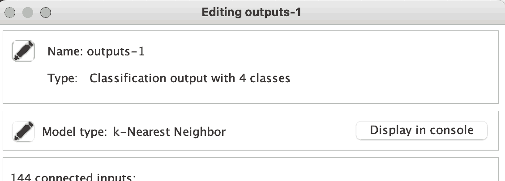
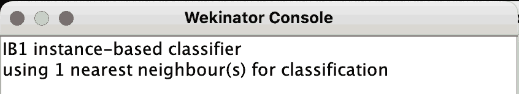

# Wekinator — proximity classification

[← Back to the main project](../../README.md)

We used Wekinator to classify how close a person appeared to our webcam. It sits between Processing, which prepares the camera image, and the Arduino, which controls the kinetic movement and LED ring. This page explains the three versions we trained, the problems we encountered when changing locations, and how to run the final model.

## 1. How Wekinator fits into the installation

`Webcam → Processing (16 × 9 grayscale image) → Wekinator (class 1–4) → Processing (confirmed class and serial command) → Arduino (servo and LED ring)`

Processing converts each camera frame into **144 normalised grayscale values** and sends them to Wekinator using OSC. Wekinator predicts one of four classes. Processing then checks successive predictions before sending a command to the Arduino. Wekinator itself does **not** control the servo or LED ring.

| Connection | Setting |
|---|---|
| Processing → Wekinator | `/wek/inputs`, UDP port `6448`; 144 values |
| Wekinator → Processing | `/wek/outputs`, UDP port `12000`; class `1`–`4` |
| Processing → Arduino | USB serial at `9600` baud |

## 2. Why we made three versions

We first trained the classifier in one location. It appeared to work there, but when we moved the webcam and tested it somewhere else, the FAR, MEDIUM and NEAR predictions became less consistent. We realised that the model was receiving a grayscale image of the **whole scene**, not a direct distance measurement. A different background or lighting condition could change the input even when someone stood at a similar distance.

To address this, we recorded more examples in different locations instead of continuing to train in the original space. We also trained at the venue where we would demonstrate the installation, so the model would have seen that environment beforehand.

| Version | Saved project | Labelled examples | What changed |
|---|---|---:|---|
| **Project 1 — Initial** | [`WekinatorProject/`](WekinatorProject/) | 399 | Initial four-class dataset, trained in one location |
| **Project 2 — Expanded** | [`WekinatorProject2/`](WekinatorProject2/) | 718 | Added 319 examples as we started training in other environments |
| **Project 3 — Final** | [`WekinatorProject3/`](WekinatorProject3/) | **2,029** | Added 1,311 more examples, including examples from the assessment venue |

During live testing, we found that the larger dataset gave more consistent classifications, especially for scenes that had been difficult to distinguish before. We kept all three project folders to show how the training developed. **Project 3 is the final model used in the installation.**

## 3. Training data and class balance

To collect examples, we kept the Processing sketch running so Wekinator continued receiving the 144 camera values. We selected the class we wanted to train, then recorded examples of that scene. For **EMPTY**, nobody was visible in the camera view. For **FAR**, **MEDIUM** and **NEAR**, we changed our position relative to the webcam.

| Class | Project 1 | Project 2 | Project 3 |
|---|---:|---:|---:|
| **1 — EMPTY** | 91 | 178 | 551 |
| **2 — FAR** | 117 | 267 | 671 |
| **3 — MEDIUM** | 99 | 144 | 505 |
| **4 — NEAR** | 92 | 129 | 302 |
| **Total** | **399** | **718** | **2,029** |

These counts come from the saved `current/currentData.arff` files. We collected fewer **NEAR** examples because bringing a face or body close to the webcam produced a fairly obvious visual change: the person filled much more of the frame, and this state seemed easier to recognise during our testing. **FAR** and **MEDIUM** were harder to distinguish consistently, particularly when we changed locations, so we focused more of our recording on those classes. This explains the uneven distribution in our final dataset.

## 4. Model and output configuration

The saved projects use a **1-nearest-neighbour classifier (1-NN, k = 1)**. When Wekinator receives a new set of 144 values, it compares them with the recorded examples and predicts the class of the closest match.

The screenshots below show the Wekinator classifier configuration we inspected. The output settings identify a k-nearest-neighbour classifier with 144 connected inputs and four classes, while the console reports one nearest neighbour (k = 1). These are cropped views of the original screenshots.



*Wekinator output configuration: k-nearest-neighbour classification with four classes and 144 connected inputs.*



*Wekinator console confirming that the classifier uses one nearest neighbour (k = 1).*

The saved projects show that we kept the same 1-NN setting throughout development while focusing on collecting better training examples. This suited our workflow: when we noticed a misclassification, we could record more labelled examples and retrain without writing our own recognition rules. We did not formally compare 1-NN with other classifiers. One weakness of this approach in our setup was that the closest match could reflect similarities in **lighting or background**, rather than only the person's apparent distance.

| Wekinator class | Scene | Processing command | Intended physical response |
|---|---|---|---|
| **1** | EMPTY — no person | `stop` | Servo returns to 0°; LEDs off |
| **2** | FAR | `far` | Servo sweeps 0–5°; low blue brightness |
| **3** | MEDIUM | `medium` | Servo sweeps 0–15°; medium blue brightness |
| **4** | NEAR | `near` | Servo sweeps 0–30°; highest blue brightness |

The Arduino sets the movement intervals and LED values; see the [main README](../../README.md) and the [Arduino source](../arduino/FinalSG90ProximityController/FinalSG90ProximityController.ino). FAR, MEDIUM and NEAR are **visual categories**, not measured distances in metres.

## 5. What we observed while testing

After adding examples from different locations, we noticed that classification became more stable, particularly for **FAR** and **MEDIUM**. Those classes had caused the most difficulty when we moved away from the original training environment.

We also found that Wekinator could classify **other people**, even though the training examples had been collected using only one member of our group. This was encouraging, as we were initially unsure whether the model would depend too heavily on the appearance of the person used for training. A possible explanation is that the 16 × 9 grayscale image retains broader visual changes, such as how much of the frame a person occupies, rather than detailed facial features. We did not test which image features the model relied on, so this remains an explanation rather than a confirmed finding.

Although we noticed improvements during testing, we did not formally measure the accuracy of each model. Our evaluation was mainly based on observing how the classifier responded in different environments and when other people interacted with it. The [testing documentation](../../tests/README.md) and [results log](../../tests/TEST_RESULTS.md) cover the wider software and hardware checks.

Processing screenshots show the predicted class, confirmed class and outgoing command. They are evidence of the software response, not necessarily of the physical output—especially when the Processing display reads **Arduino: NOT READY**.

## 6. Saved files and how to run Project 3

Each project contains the same types of files. We kept their original folder structures so the saved models and training data can be reopened in Wekinator.

```text
software/wekinator/
├── README.md
├── WekinatorProject/                   # Project 1
├── WekinatorProject2/                  # Project 2
└── WekinatorProject3/                  # Project 3 — FINAL
    ├── WekinatorProject3.wekproj       # Saved Wekinator project
    ├── inputConfig.xml                 # Input count and OSC input address
    ├── outputConfig.xml                # Class output and OSC destination
    └── current/
        ├── currentData.arff            # Labelled training examples
        └── models/
            └── model0.xml              # Saved classifier
```

To reproduce the final classifier:

1. Open [`WekinatorProject3.wekproj`](WekinatorProject3/WekinatorProject3.wekproj) in Wekinator.
2. Check that it expects **144 inputs**, **one four-class output**, and the OSC settings listed in Section 1.
3. Run the [Processing sketch](../processing/FinalSG90ProximityControllerProcessing/FinalSG90ProximityControllerProcessing.pde) with the webcam connected so Wekinator receives live inputs.
4. Load or retrain the saved model if needed, then start Wekinator's **Run** mode.
5. Check that the predicted and confirmed classes change as expected. To test the servo and LED ring, follow the power and connection instructions in the [main README](../../README.md).

## 7. Limitations and next steps

Our biggest difficulty was getting the classifier to work consistently when we changed environments. Recording data in different locations helped during development, but training at the assessment venue also means that venue was no longer an unseen test environment.

If we continued the project, we would first test **all three saved models on the same new scenes** to see how much the predictions actually improved. We would pay particular attention to FAR and MEDIUM, since those were the hardest classes for us to separate, and test under different backgrounds and lighting conditions.

We would also collect examples from **more than one person** and test on people who were not part of the training set. That would help us check whether the results we noticed informally hold up more consistently. Based on those tests, we could adjust the number of examples per class and compare our current **1-NN** model with a larger value of `k` or another classifier. We did not complete those comparisons during this project.

---

**Final classifier:** [`WekinatorProject3/`](WekinatorProject3/) · **Overall installation:** [main README](../../README.md)