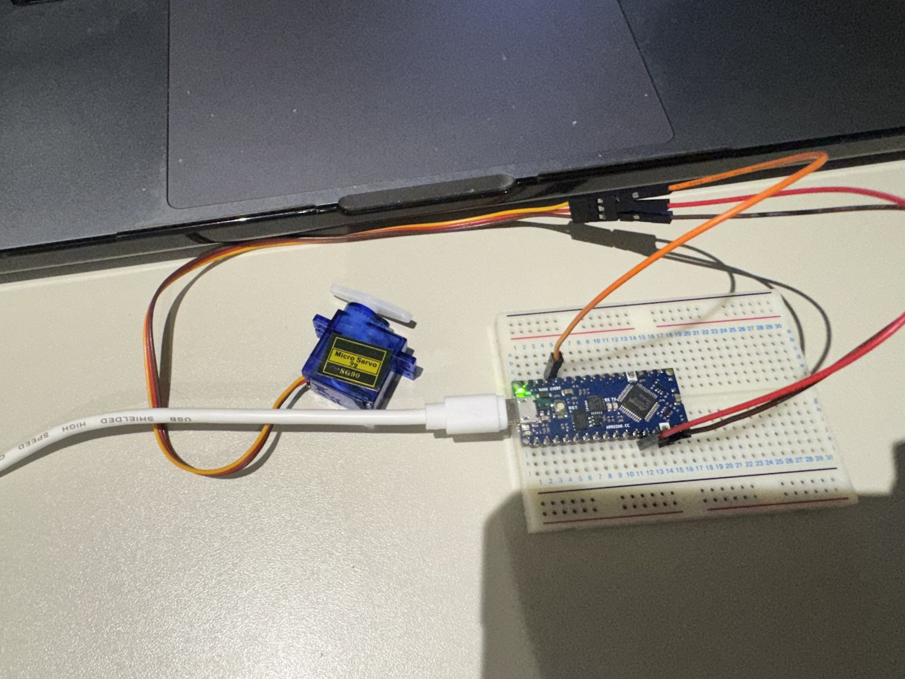
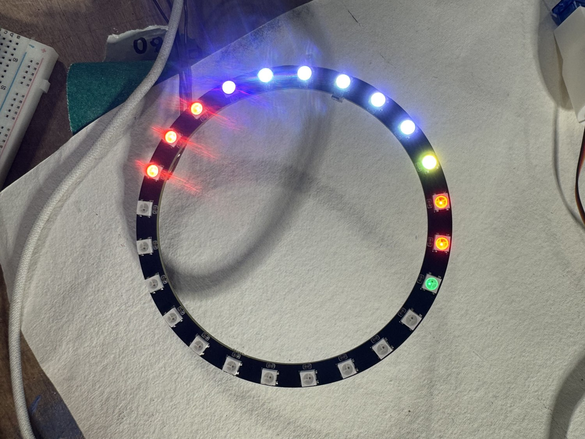
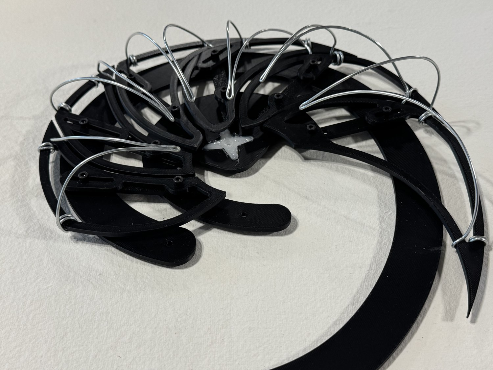
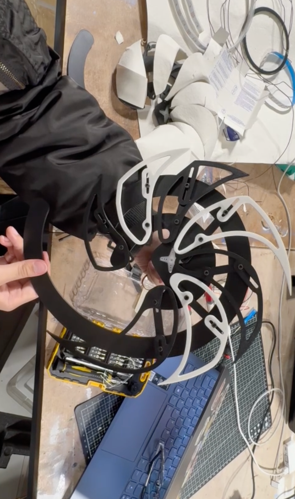

# Tests — debugging the installation

[← Main project](../README.md) · [Processing documentation](../software/processing/README.md) · [Final Arduino controller](../software/arduino/FinalSG90ProximityController/FinalSG90ProximityController.ino)

## 1. Why we tested the parts separately

While developing our proximity-responsive installation, we used small test sketches whenever we needed to check one part of the system without involving everything else. For instance, we could test the servo directly before adding Wekinator, or send a command from Processing without using the webcam. This made it easier to tell whether a problem came from the hardware, serial communication or the classifier.

We started with basic servo and communication checks, then moved towards the complete webcam-to-Arduino interaction. The tests were mainly for debugging during development, rather than a formal performance study.

## 2. Test overview

| Test | What we were checking |
|---|---|
| **01 — [Servo position](01-servo-position/README.md)** | Whether the SG90 responds to position commands on its own |
| **02 — [Servo pulse diagnostic](02-servo-pulse-diagnostic/README.md)** | How the servo responds to different pulse-width commands |
| **03 — [Arduino serial](03-arduino-serial/README.md)** | Whether Arduino recognises incoming text commands |
| **04 — [Processing → Arduino](04-processing-to-arduino/README.md)** | Sending commands directly from Processing, without Wekinator |
| **05 — [Wekinator classification](05-wekinator-classification/README.md)** | Checking camera inputs and class predictions separately from the hardware |
| **06 — [End-to-end integration](06-end-to-end/README.md)** | Checking the complete webcam → Wekinator → Arduino interaction |
| **07 — [LED ring](07-led-ring/RingLEDLight/RingLEDLight.ino)** | Checking the 24-pixel LED ring independently |
| **08 — [Archived early servo serial experiment](08-early-servo-serial/README.md)** | Preserved two-command `start`/`stop` receiver for preliminary Processing-to-Arduino communication (not a verified Wekinator integration result) |

The [archived two-command servo receiver](08-early-servo-serial/README.md) is retained as historical development code. It is distinct from the later four-command serial and end-to-end tests, and its original source does not independently establish communication with Wekinator.

### Standalone hardware checks

| Servo and Arduino test setup | LED ring during an earlier colour test |
|:---:|:---:|
|  |  |

These photographs show the standalone setups we used while working through the servo and lighting behaviour. The LED photograph shows an earlier colour experiment; the final installation uses blue light with different brightness levels.

## 3. How the tests developed with the project

Our earliest Arduino tests used fixed target positions. The SG90 could move when we tested it on its own, but attaching the mechanical shell changed what we needed from the motor. With the shell fitted, we found that the servo struggled with the added load, and the assembly needed more weight or support to stay stable while moving. This became clearer during physical assembly than during the standalone tests.

We adjusted the commanded movement to suit the assembled mechanism, moving from fixed positions of 0°, 10°, 20° and 30° towards continuous sweeps with different ranges and speeds for each proximity class. This did not make the servo more powerful, but it allowed us to design the motion around the movement the structure could accommodate. The earlier fixed-angle sketches help show how our approach to controlling the movement developed.

### Mechanical integration footage

We recorded [the shell assembly test](../media/videos/mechanical-shell-assembly-0590.mp4) and [a closer view of the mechanism](../media/videos/mechanical-shell-closeup-0601.mp4) while handling and supporting the assembled structure. Along with our [earlier mechanism assembly clip](../media/videos/mechanism-assembly-test.mp4), they give a clearer sense of the structure we were trying to move and the support it required during development. These clips provide context for what we observed, rather than measurements of servo torque or load.

  

*Handling the curved shell components during mechanical integration.*

The current Test 04 uses the final four-command protocol: `stop`, `far`, `medium` and `near`. It also repeats the command every 200 milliseconds, matching the final Processing controller.

Test 06 uses a separate Processing sketch and Arduino receiver to check whether Wekinator's predictions can trigger physical servo movement. Rather than using the final continuous sweeping behaviour, this test moves the servo to fixed positions of 0°, 10°, 20° and 30°. We kept this simpler test to examine communication between Wekinator, Processing and Arduino before integrating the final movement and LED controls.

The LED ring was tested on its own before being combined with the servo. Its standalone [Arduino sketch](07-led-ring/RingLEDLight/RingLEDLight.ino) is kept under Test 07. For the camera and classification side, the [Processing screenshots](../README.md#classification-in-processing) show several of the predicted states. The [final demonstration](../media/videos/final-demonstration.mp4) shows the assembled installation; it is separate from the earlier fixed-angle Test 06 sketch.

## 4. What we observed

We ran the original debugging tests during development and eventually got the components and communication working. Some of our first servo checks did not behave as expected. We continued adjusting the setup and eventually got the debugging tests working, although we did not keep detailed measurements for every retest.

Our [test results summary](TEST_RESULTS.md) records what we checked and what was established during development. We have not added positioning-accuracy figures, measured response times or classifier-accuracy percentages that were not collected.

## 5. Reproducing a check

To reproduce a check, use its corresponding test sketch. For Arduino tests, select the **Nano Every** and the correct port. Close the Arduino Serial Monitor before a Processing sketch opens the same serial connection. The servo and LED ring need an appropriate **external regulated 5 V supply with a common ground**; check that the moving parts have clearance before powering the mechanism.

For camera and classifier tests, Processing uses the **Video** and **oscP5** libraries, and Wekinator receives **144 grayscale inputs** on UDP **6448** and sends its class output to UDP **12000**. Run only one application listening on that output port at a time.

The individual test sketches have their own settings. To run the finished installation, use the [final Processing sketch](../software/processing/FinalSG90ProximityControllerProcessing/FinalSG90ProximityControllerProcessing.pde) and [final Arduino sketch](../software/arduino/FinalSG90ProximityController/FinalSG90ProximityController.ino) together with [Wekinator Project 3](../software/wekinator/WekinatorProject3/WekinatorProject3.wekproj).